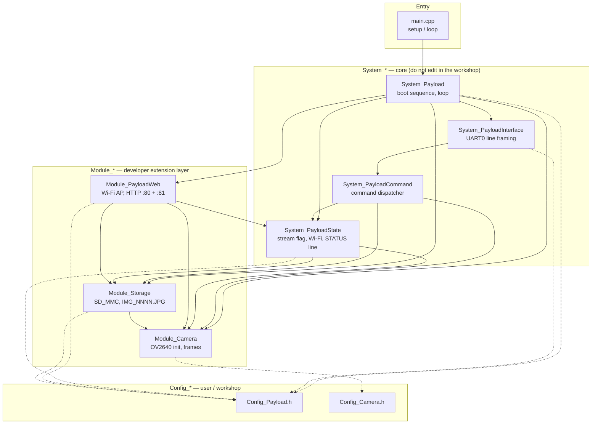
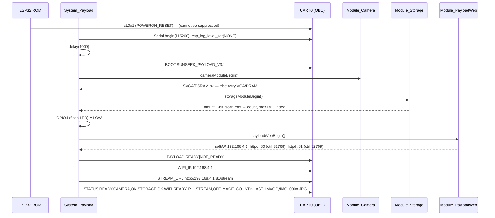
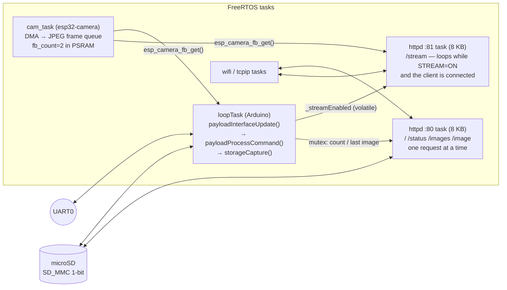
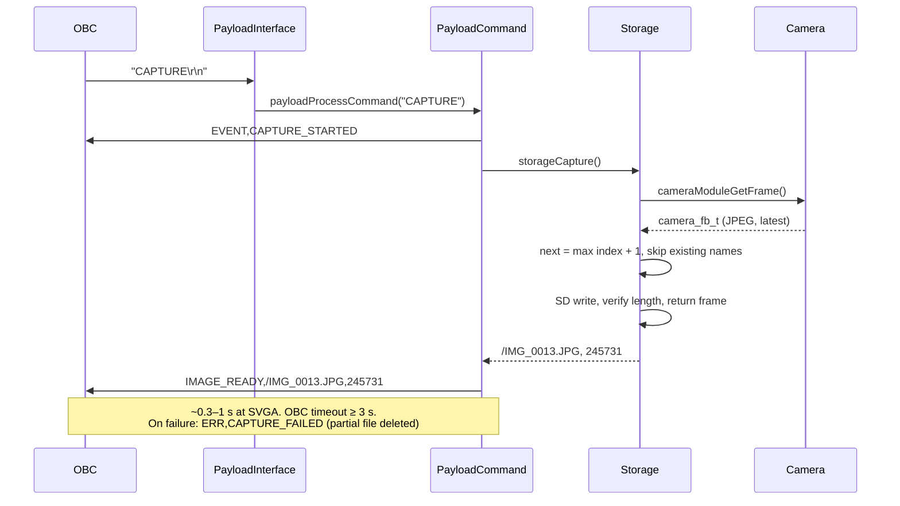
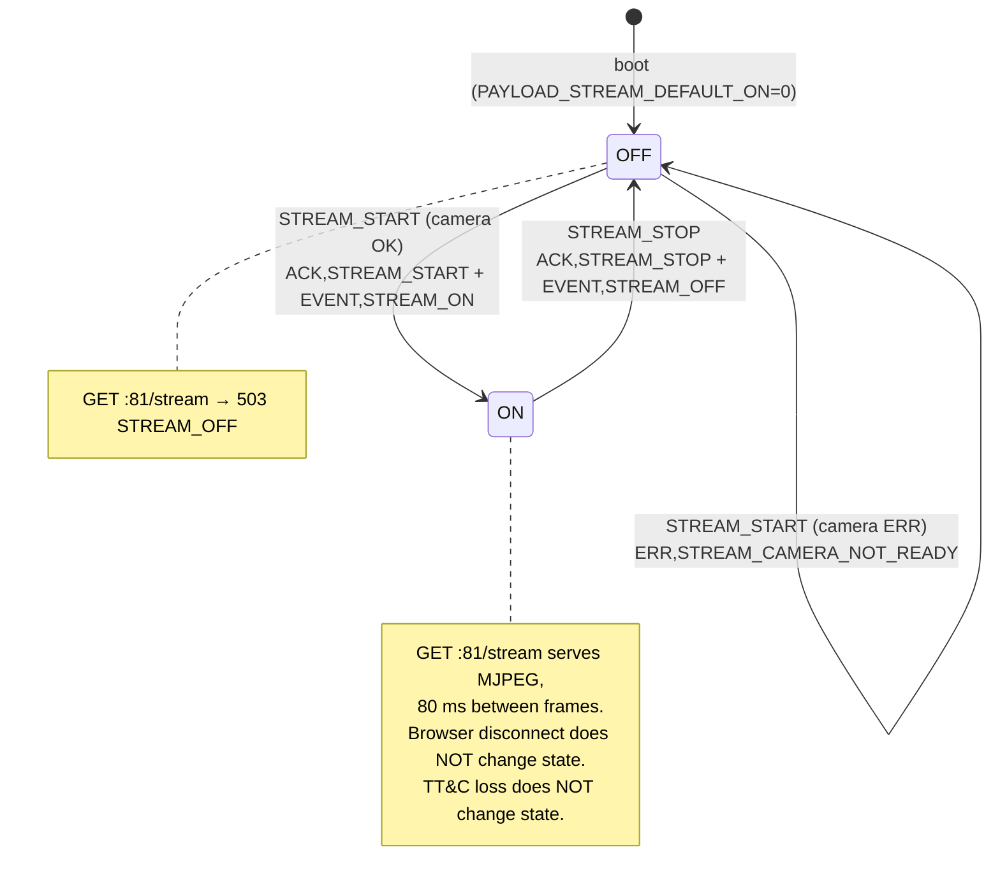

# SunSeek ESP32-CAM Payload Firmware — program structure (v3.1)

## 1. System context

```
Ground Station ──BLE NUS──▶ SunSeek OBC (ESP32-S3) ──UART1 GPIO41/42 ──▶ ESP32-CAM U0R/U0T   [control plane]
Ground Station / browser ◀──── Wi-Fi AP "SUNSEEK-PAYLOAD" ◀── HTTP :80 (API) + :81 (/stream) ── ESP32-CAM   [data plane]
```

The two planes are independent by design: losing the TT&C link does not change the stream state, and
the HTTP side can be reached without the OBC. `CAMERA`, `STORAGE`, `WIFI` and `STREAM` are four
independent status fields; `PAYLOAD READY` = camera + Wi-Fi (storage is not needed for streaming).

## 2. Layers and files



| File | Responsibility | Called from |
|---|---|---|
| `main.cpp` | `setup()` → `payloadSystemBegin()`, `loop()` → `payloadSystemUpdate()` + `delay(2)` | Arduino `loopTask` |
| `System_Payload.cpp` | Boot order: UART → camera → storage → LED → Wi-Fi/HTTP → report | `setup()` |
| `System_PayloadInterface.cpp` | `Serial` RX line assembly (CR/LF, 95-char max, overflow discard), `payloadSendLine()` | `loop()` |
| `System_PayloadCommand.cpp` | `payloadProcessCommand()`: 11 commands → response lines | interface |
| `System_PayloadState.cpp` | `_streamEnabled`, `_apStarted`, `payloadReady()`, `payloadStatusLine()`, `payloadStreamURL()` | command, web |
| `Module_Camera.cpp` | AI-Thinker pin map, `esp_camera_init` (+ one fallback), `GetFrame/ReturnFrame` | storage, web(81) |
| `Module_Storage.cpp` | `SD_MMC.begin(1-bit, 20 MHz)`, scan `IMG_NNNN.JPG` → max index, `storageCapture()` (mutex-guarded metadata) | command, web(80) |
| `Module_PayloadWeb.cpp` | `WiFi.softAP`, two `esp_http_server` instances, handlers `/ /status /images /image` (80) and `/stream` (81) | boot; httpd tasks |

## 3. Boot sequence



## 4. Runtime tasks



Why two HTTP servers: `esp_http_server` executes every handler of one instance sequentially in one task.
`/stream` is a long-running handler, so with a single server (v3.0) an open stream made the whole API
unreachable. The API stays responsive on port 80 while port 81 is busy streaming.

Shared state and how it is protected:

| Data | Writer | Reader | Protection |
|---|---|---|---|
| `_streamEnabled` | loopTask (STREAM_START/STOP) | httpd :81 loop condition | `volatile bool` (single word) |
| `_imageCount`, `_lastImage`, `_lastImageSize`, `_nextIndex` | loopTask (CAPTURE, scan) | httpd :80 (`/status`), loopTask | FreeRTOS mutex, getters return copies |
| camera frame buffers | cam_task | loopTask + httpd :81 | driver queue (thread-safe), 2 buffers |
| `_streamClients` | httpd :81 | httpd :80 (`/status`) | `std::atomic<uint32_t>` |
| `Serial` TX | loopTask only | — | not shared (HTTP tasks never print) |

## 5. UART command flows





Command table (all responses end with CRLF):

| Command | Response | Needs |
|---|---|---|
| `PING` | `PONG,CAMERA` | — |
| `STATUS` | `STATUS,<READY/NOT_READY>,CAMERA,<OK/ERR>,STORAGE,<OK/ERR>,WIFI,<READY/NOT_READY>,IP,<ip>,STREAM,<ON/OFF>,IMAGE_COUNT,<n>,LAST_IMAGE,<path>` | — |
| `CAPTURE` | `EVENT,CAPTURE_STARTED` then `IMAGE_READY,<path>,<bytes>` or `ERR,CAPTURE_FAILED` | camera + storage |
| `IMAGE_COUNT` | `IMAGE_COUNT,<n>` | — |
| `LAST_IMAGE` | `LAST_IMAGE,<path>,<bytes>` | — |
| `STREAM_START` | `ACK,STREAM_START` + `EVENT,STREAM_ON`, or `ERR,STREAM_CAMERA_NOT_READY` | camera |
| `STREAM_STOP` | `ACK,STREAM_STOP` + `EVENT,STREAM_OFF` | — |
| `STREAM_STATUS` | `STREAM_STATUS,<ON/OFF>` | — |
| `VERSION` *(3.1)* | `VERSION,3.1` | — |
| `STREAM_URL` *(3.1)* | `STREAM_URL,http://<ip>:81/stream` | — |
| `STORAGE_REMOUNT` *(3.1)* | `ACK,STORAGE_REMOUNT,<OK/ERR>` | — |
| other | `ERR,UNKNOWN_COMMAND`; line > 95 chars → `ERR,LINE_TOO_LONG` | — |

## 6. HTTP endpoints

| Port | Path | Returns | Requires |
|---|---|---|---|
| 80 | `GET /` | HTML engineering page: status JSON, image links, live stream `` from :81 | — |
| 80 | `GET /status` | JSON: `fw ready camera storage wifi stream stream_port stream_clients image_count last_image last_image_size frame_size psram camera_fallback` | — |
| 80 | `GET /images` | JSON array `[{name,size}]` of `*.JPG` in the card root; 503 `STORAGE_NOT_READY` | storage |
| 80 | `GET /image?name=/IMG_0001.JPG` | `image/jpeg` (chunked, 2 KB); 400 bad/unsafe name, 404 not found, 503 | storage |
| 81 | `GET /stream` | `multipart/x-mixed-replace` MJPEG; 503 `CAMERA_NOT_READY` / `STREAM_OFF` | camera + STREAM=ON |

All responses carry `Access-Control-Allow-Origin: *` and `Cache-Control: no-store`.

## 7. Hardware resources (AI Thinker ESP32-CAM)

| Function | GPIO | Note |
|---|---|---|
| Camera data Y2..Y9 | 5, 18, 19, 21, 36, 39, 34, 35 | fixed by the module |
| XCLK / PCLK / VSYNC / HREF | 0 / 22 / 25 / 23 | GPIO0 is also the boot-mode strap |
| SCCB SDA / SCL | 26 / 27 | |
| Camera PWDN | 32 | |
| SD_MMC 1-bit: CLK / CMD / D0 | 14 / 15 / 2 | D1 (4), D2 (12), D3 (13) stay free in 1-bit mode |
| Flash LED | 4 | parked LOW by firmware |
| UART0 TX / RX | 1 / 3 | programmer **and** OBC — never both at once |
| Frame buffers | PSRAM (4 MB) | 2 × SVGA JPEG; fallback 1 × VGA in DRAM |
| Flash | 4 MB, `huge_app.csv` | app 3 MB (1.13 MB used), SPIFFS 1 MB |

## 8. Review of v3.0 — problems found and how 3.1 fixes them

| # | Severity | v3.0 problem | Effect | 3.1 fix |
|---|---|---|---|---|
| 1 | **High** | One `esp_http_server` instance runs every handler in one task; `/stream` loops until STREAM_STOP or disconnect | While anyone views the stream, `/status`, `/images`, `/image` hang → ground station loses HTTP observation | Second server on port 81 with its own `ctrl_port` for `/stream` |
| 2 | **High** | `_lastImage` (`String`) written by the UART task during CAPTURE and read by the HTTP task in `/status`, unguarded | Occasional heap corruption / reset when a capture coincides with a status poll | Mutex; getters return copies |
| 3 | **High** | All state is `static` in header files (header-only design) | Correct only while everything is a single `.ino` translation unit; any added `.cpp` silently gets private copies | Proper `.h/.cpp` split |
| 4 | Medium | httpd default stack 4 KB; `/image` has ~1.4 KB of locals plus `String` temporaries | Stack-overflow reset under load | `stack_size = 8192`, static 2 KB I/O buffer |
| 5 | Medium | `storageScan` keeps the *last file in FAT directory order* as `LAST_IMAGE`; count includes any `.JPG` | After reboot `LAST_IMAGE` can be an old file; next-name search starts from a wrong index | Parse `IMG_NNNN`, track max index |
| 6 | Medium | Any system log (`esp_camera_init` error, sdmmc, wifi) prints on UART0 = OBC link | OBC parser receives non-protocol lines | `CORE_DEBUG_LEVEL=0` + `esp_log_level_set("*", NONE)`; ROM banner still remains — OBC must ignore unknown lines |
| 7 | Medium | Short SD write accepted if `w != 0` | Truncated JPEG reported as `IMAGE_READY` (card full / glitch) | Compare with frame length, delete partial, `ERR,CAPTURE_FAILED` |
| 8 | Medium | UART line > 95 chars: tail parsed as a new command | Spurious `ERR,UNKNOWN_COMMAND`, or an unintended valid command | Discard oversize line, `ERR,LINE_TOO_LONG` |
| 9 | Medium | PlatformIO `esp32cam` board defaults to `default.csv` (1.25 MB app) | 1.13 MB binary = 90 % full; any growth fails to link | `huge_app.csv` |
| 10 | Low | `payloadWifiReady()` = `getMode()==WIFI_AP` | Reports WIFI READY even if `softAP()` failed | Store the `softAP()` result |
| 11 | Low | No fallback if `esp_camera_init` fails (e.g. PSRAM not detected) | CAMERA ERR for the whole session | Retry once: VGA, 1 buffer, DRAM |
| 12 | Low | `/image` sends a 0-byte chunk if `read()` returns 0 | Response terminated early (rare) | Guard |
| 13 | Low | `/image` does not URL-decode `name` | `%2FIMG_0001.JPG` → 404 | `%XX` decode |
| 14 | Low | Flash LED GPIO4 left floating | Glows / flickers | Parked LOW (`PAYLOAD_FLASH_LED_OFF`) |
| 15 | Low | Frame format not checked | Raw data written as `.JPG` if `pixel_format` is changed | Check `fb->format == PIXFORMAT_JPEG` |
| 16 | Low | `httpd_uri_t x = {.uri=...}` designated initialisers | Fragile across IDF 4.4 / 5.x struct layouts | Helper that fills a zeroed struct |
| 17 | Low | STA mode: no reconnect after AP loss | WIFI NOT_READY until reboot | `WiFi.setAutoReconnect(true)` |
| 18 | Info | `CAPTURE` blocks `loop()` ~0.3–1 s; `delay(1000)` at boot | OBC must wait for `IMAGE_READY` with a ≥ 3 s timeout | Documented (unchanged) |
| 19 | Info | Wi-Fi start draws a current spike; board often fed from an FTDI 3V3 pin | Brown-out resets at `payloadWebBegin()` | Hardware: 5 V ≥ 500 mA supply |
| 20 | Info | Second `/stream` client | Waits until the first disconnects (single handler task) | Documented; `max_open_sockets` 2 on :81 |
