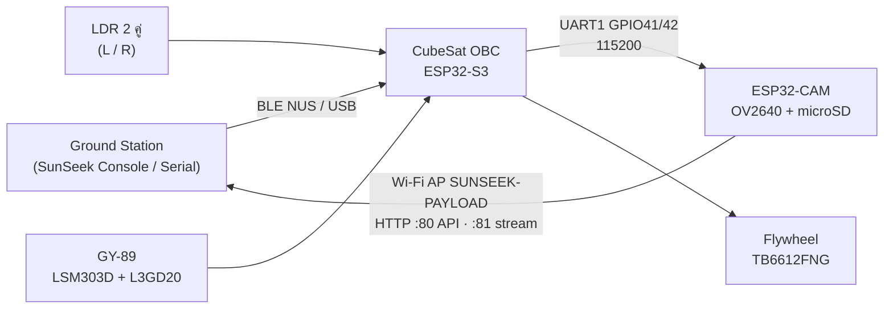

# 🛰️ SunSeek CubeSat: Firmware Team Dinonaut from DSKKU

Firmware ที่ทีมเราใช้ในการแข่งขัน CubeSat Sensor Competition ประกอบด้วยสองส่วน คือ **CubeSat OBC (ESP32-S3)** และ **ESP32-CAM Payload** ทั้งสองส่วนพัฒนาต่อจาก starter firmware ของผู้จัด

เราเปิดโค้ดนี้ไว้ให้ทีมอื่นนำไปศึกษาและทดลองต่อ 🙏

> **หลักการที่เรายึด:** คำสั่ง (telecommand) และ protocol เดิมของผู้จัด**ยังใช้ได้ทั้งหมด** ทุกอย่างที่เราทำเป็นการเพิ่มเข้าไปหรือแก้บั๊กเท่านั้น

---

## 📦 ภาพรวมระบบ



- **Control plane:** Ground Station สั่งงานผ่าน BLE/USB ไปที่ OBC จากนั้น OBC ส่งต่อคำสั่งให้กล้องผ่าน UART
- **Data plane:** รูปภาพและ stream ส่งตรงจากกล้องไปยัง Ground Station ผ่าน Wi-Fi

---

## 📁 โครงสร้าง Repository

```
.
├── SunSeek_Platform_Firmware_v3_0/PlatformIO/      # CubeSat OBC (ESP32-S3)
│   ├── platformio.ini
│   ├── include/   Config_*.h                       # ค่าที่ต้องปรับ: pin, calibration, ADCS, mission
│   ├── src/       Module_*.h  System_*.h  main.cpp
│   ├── tools/                                      # suncal_fit.py, host tests (รันบน PC)
│   └── Log_Dev.md                                  # บันทึกทุกการเปลี่ยนแปลงจากของผู้จัด
├── SunSeek_ESP32CAM_Payload_Firmware_v3_0/PlatformIO/   # ESP32-CAM Payload v3.1
│   ├── platformio.ini
│   ├── src/
│   ├── README_PLATFORMIO.md                        # วิธีแฟลช + bring-up checklist
│   ├── CHANGELOG_v3_1.md                           # ทุกจุดที่เปลี่ยนจาก v3.0
│   └── docs/ARCHITECTURE.md
└── Tools/
    └── sunseek_console.html                        # Ground station บน Chrome (Web Bluetooth / Web Serial)
```

> ถ้าโครงสร้างใน repo จริงต่างจากนี้ ให้ดูชื่อโฟลเดอร์ตามจริงเป็นหลัก

---

## 🔌 Hardware และ Pinout (ชุดแข่งขัน Rev B)

| GPIO (ESP32-S3) | ใช้กับ | หมายเหตุ |
|---|---|---|
| 16 / 17 | SUN_L / SUN_R | LDR ข้างละ 2 ตัวต่อขนาน (ADC2: ใช้ Wi-Fi บน OBC ไม่ได้) |
| 8 / 9 | I2C SDA / SCL | GY-89: LSM303D 0x1D, L3GD20 0x6B, BMP180 0x77 |
| 1 | PWMA | TB6612FNG → flywheel (แกน Z) |
| 38 / 39 | AIN1 / AIN2 | TB6612FNG |
| 41 / 42 | UART1 TX / RX | ต่อไป ESP32-CAM U0R (GPIO3) / U0T (GPIO1) |
| 43 / 44 | UART0 | USB (CP210x) สำหรับอัปโหลดและ TT&C |

> ⚠️ ในโค้ดของเรา pin ซ้าย/ขวาของ sun sensor ตั้งตามบอร์ดเรา (`SUN_LEFT_PIN` / `SUN_RIGHT_PIN` ใน `Config_Sensor.h`) ให้ตรวจสอบกับบอร์ดของทีมตัวเองก่อนใช้

---

## 🛠️ Build และ Flash

ต้องมี **VS Code + PlatformIO** และควรติดตั้งให้เรียบร้อยก่อนวันแข่ง เพราะการเปิดโปรเจกต์ครั้งแรกจะดาวน์โหลด toolchain ประมาณ 400 MB

### CubeSat OBC (ESP32-S3)

```sh
cd SunSeek_Platform_Firmware_v3_0/PlatformIO
pio run                  # build
pio run -t upload        # flash ผ่าน USB
pio device monitor       # 115200
```

ถ้าติดตั้ง toolchain pioarduino ไม่ได้ ให้ใช้ env สำรอง `sunseek_core2` (espressif32@6.9.0)

### ESP32-CAM Payload

```sh
cd SunSeek_ESP32CAM_Payload_Firmware_v3_0/PlatformIO
pio run -e esp32cam
pio run -e esp32cam -t upload
```

ESP32-CAM ไม่มี USB จึงต้องแฟลชผ่าน FTDI หรือ CP210x:

| FTDI | ESP32-CAM |
|---|---|
| TX | U0R (GPIO3) |
| RX | U0T (GPIO1) |
| GND | GND |
| **5V** (ห้ามใช้ 3V3) | 5V |

1. **ถอดสาย UART จาก OBC ออกก่อน** เพราะใช้ขาเดียวกับ FTDI
2. จั๊มพ์ IO0 ลง GND → กด RST → สั่ง upload → ถอดจั๊มพ์ → กด RST
3. ใช้ไฟ 5V ที่จ่ายได้ ≥ 500 mA ถ้าใช้ไฟจากขา 3V3 ของ FTDI บอร์ดจะ brownout ตอนเปิด Wi-Fi
4. ถ้า upload timeout ให้ตั้ง `upload_speed = 115200` ใน `platformio.ini`

---

## ✨ สิ่งที่เราเปลี่ยนจาก Firmware ของผู้จัด

### 1) CubeSat OBC (base: ผู้จัด v3.0)

| หัวข้อ | ของเดิม | ของเรา |
|---|---|---|
| **Sun sensor** | NDV จากค่า ADC อ่านครั้งเดียว ช่วงวัดประมาณ −50…+60° | วิธี conductance + log ratio อ่านซ้ำ 16 ครั้งต่อข้าง ช่วงวัด **±70°** error ประมาณ **1° rms** (ตั้ง `SUN_ALGORITHM 0` เพื่อกลับไปใช้วิธีเดิม) |
| **Yaw estimator** | MA(10) + complementary filter | **Relative Yaw EKF** 2 state (yaw + gyro bias) รวม gyro กับ magnetometer เพิ่ม reference `ADCS_REFERENCE,YAW` สั่งหมุนได้ ±180° จากจุดศูนย์ที่ตั้งด้วย `YAW_ZERO` |
| **Mission** | ค้างที่ CAPTURING หลังเป้าแรก | ส่ง `CAPTURE` → รอ `IMAGE_READY` (timeout 8 s, retry 1 ครั้ง) → ไปเป้าถัดไป**โดยไม่ออกจาก AUTO** → COMPLETE |
| **เลือกถ่ายภาพ** | ถ่ายทุกเป้า | เลือกได้ทีละเป้าด้วย `MISSION_TARGET,<มุม>,<tol>,<hold>,<0\|1>` |
| **Events** | ไม่มี | `EVT,MISSION_STATE / _TARGET_HELD / _CAPTURE / _IMAGE / _CAPTURE_SKIPPED / _NEXT_TARGET / _COMPLETE` |
| **Calibration** | มี `GYRO_OFFSET` กับ `MAG_CAL_*` อยู่ในโค้ด แต่เรียกใช้ไม่ได้ | route คำสั่งให้ใช้ได้แล้ว |
| **Magnetometer** | 6.25 Hz | 50 Hz (ต้องทำ `MAG_CAL` ใหม่หลังแฟลช) |
| **Sign convention** | แต่ละ sensor ใช้ทิศไม่ตรงกัน | ทั้งระบบใช้ **+ = หมุนขวา (ตามเข็มนาฬิกาเมื่อมองจากด้านบน)** |
| **ULN2003** | ขาลอย | park ไว้ที่ LOW |

ดูรายละเอียดทุกจุด (ทุกจุดมี tag `[Team]` หรือ `[PIO port]`) ได้ที่ `Log_Dev.md`

### 2) ESP32-CAM Payload (base: ผู้จัด v3.0 → v3.1)

- **ย้าย `/stream` ไปที่ port 81:** ในของเดิม ระหว่างมีคนดู stream ทั้ง `/status`, `/images`, `/image` จะไม่ตอบเลย
- **แก้บั๊ก thread-safety:** ตัวแปรที่ UART task กับ HTTP task ใช้ร่วมกันไม่มี mutex ป้องกัน ทำให้ heap เสียได้
- **ปรับขนาดหน่วยความจำ:** เพิ่ม HTTP stack จาก 4 เป็น 8 KB และใช้ partition `huge_app.csv` (3 MB) เพราะ default 1.25 MB เต็มไปถึง 90%
- **ปิด system log บน UART0:** OBC จะได้เห็นเฉพาะบรรทัด protocol
- **ทนทานขึ้น:**
  - ถ้า PSRAM ใช้ไม่ได้ กล้องจะ fallback เป็น VGA ให้อัตโนมัติ
  - ถ้า SD เขียนไม่ครบจะรายงานเป็น error แทนที่จะบอกว่าสำเร็จ
  - จำกัด Wi-Fi TX power ไว้ที่ 8.5 dBm เพื่อลด brownout
  - park ไฟแฟลช GPIO4 ไว้ที่ LOW
- **เพิ่มคำสั่งและข้อมูล:**
  - คำสั่งใหม่ `VERSION`, `STREAM_URL`, `STORAGE_REMOUNT`
  - บรรทัด `RESET_REASON,<สาเหตุ>` ตอน boot
  - field ใหม่ใน `/status`: `fw`, `psram`, `camera_fallback`, `stream_clients`
  - CORS `*` ให้ ground station บน browser ดึงข้อมูลได้

ดูรายละเอียดเพิ่มเติมได้ที่ `CHANGELOG_v3_1.md` และ `docs/ARCHITECTURE.md`

---

## 🚀 Quick Start (ตัวอย่างการใช้งาน)

### ตรวจกล้อง (ผ่าน serial monitor ของ ESP32-CAM)

```
PING            → PONG,CAMERA
CAPTURE         → IMAGE_READY,/IMG_0001.JPG,<bytes>
```

จากนั้นต่อ Wi-Fi `SUNSEEK-PAYLOAD` / `sunseek01` แล้วเปิด `http://192.168.4.1/`

### Mission แบบ YAW (สั่งผ่าน OBC)

```
ADCS_MODE,MANUAL
ADCS_REFERENCE,YAW
YAW_ZERO                         # ตั้งจุดศูนย์ที่ทิศปัจจุบัน (เก็บใน RAM: ต้องทำใหม่ทุกครั้งที่รีบูต)
MISSION_TARGET,60,4,1,1          # มุม 60°, tol 4°, hold 1 s, ถ่ายภาพ
MISSION_TARGET,-30,4,1,0         # มุม -30°, ไม่ถ่ายภาพ
MISSION_START
```

> ต้องส่ง `ADCS_MODE,MANUAL` ก่อน `MISSION_START` เสมอ ถ้าใช้โหมด MOMENTUM ให้สั่ง `ADCS_PREPARE` แล้วรอจน gyro นิ่ง (< 2 °/s) ก่อนเข้า AUTO

---

## ⚠️ ต้อง Calibrate ใหม่ก่อนใช้กับบอร์ดของทีมคุณ

ค่าในโค้ดเป็น**ค่าของบอร์ดเรา** นำไปใช้ตรงๆ ไม่ได้

| ค่า | ไฟล์ | วิธีทำ |
|---|---|---|
| Sun sensor table | `include/Config_SunCal.h` | กวาดมุมด้วย Console แท็บ *Sun cal* → บันทึก CSV → สั่ง `python3 tools/suncal_fit.py <file.csv>` |
| Mag offset/scale | `include/Config_Sensor.h` | ประกอบยานให้ครบ → `MAG_CAL_START` → หมุนช้าๆ ราบๆ 2 รอบ → `MAG_CAL_STOP` → นำค่าไปใส่ไฟล์ |
| Gyro offset | `include/Config_Sensor.h` | วางยานนิ่งๆ → `GYRO_OFFSET` |
| Sign 4 ตัว | `Config_Sensor.h`, `Config_ADCS.h` | ตรวจตามหัวข้อด้านล่าง |

**ตรวจ sign ก่อนเข้า AUTO ทุกครั้ง** (โหมด MANUAL, REACTION)

1. หมุนยานไปทางขวาด้วยมือ: `SUN_ANGLE` และ `MAG_HEADING` ต้องเพิ่มขึ้น และ body rate ต้องเป็นบวก
2. สั่ง `RW,20`: มุมต้องลดลง และ rate ต้องเป็นลบ
3. ถ้า rate ผิดทิศ ให้แก้ `IMU_BODY_RATE_SIGN` ถ้าล้อหมุนผิดทิศ ให้แก้ `ADCS_CONTROL_SIGN`

> sign ทั้ง 4 ตัวต้องเปลี่ยนไปด้วยกัน ถ้ากลับแค่ตัวเดียว ยานจะหมุนเตลิดใน AUTO

ความแม่นยำของ YAW ขึ้นอยู่กับ **magnetometer calibration** เป็นหลัก ถ้าหมุนจริง 90° แต่อ่านได้ประมาณ 73° แปลว่าต้อง cal mag ใหม่ ให้ทำใหม่ทุกครั้งที่มีการเพิ่มหรือย้ายชิ้นส่วนที่เป็นเหล็กหรือแม่เหล็ก

---

## 🖥️ SunSeek Console (ตัวเลือกเสริม)

`Tools/sunseek_console.html` เป็น ground station ที่ทำงานบน Chrome ผ่าน Web Bluetooth หรือ Web Serial มีแท็บต่อไปนี้:

- Commands
- Sun cal
- PD tune
- Momentum
- Mission (ติ๊กเลือกถ่ายภาพทีละเป้าได้)
- Payload (ดู stream, gallery, ดาวน์โหลดรูป)

> เปิดไฟล์ผ่าน `file://` หรือ `http://localhost` เท่านั้น ถ้าเปิดผ่าน https จะเรียกกล้องที่เป็น http ไม่ได้

---

## 📝 ข้อจำกัดที่รู้อยู่

- ระบบ REACTION แบบ P-law ของผู้จัดจะหยุดสั้นกว่าเป้าเล็กน้อยเมื่อแท่นทดสอบมีแรงหนืด (ประมาณ 2° ต่อการหมุน 60°) เพราะยังไม่มี integral term
- จุดศูนย์ของ YAW (`YAW_ZERO`) และ momentum profile เก็บใน RAM จึงหายเมื่อรีบูต
- ESP32 ROM จะพิมพ์ boot banner ออกทาง UART เสมอ parser ฝั่ง OBC จึงต้องข้ามบรรทัดที่ไม่รู้จัก

---

## 🙏 Credits

- **Starter firmware, hardware kit และ protocol:** ผู้จัดการแข่งขัน Thailand Young Satellite Challenge (SunSeek Platform Firmware v3.0 และ ESP32-CAM Payload Firmware v3.0)
